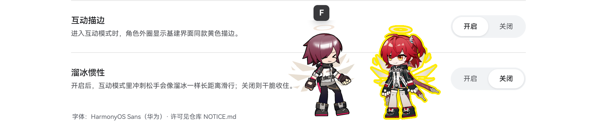
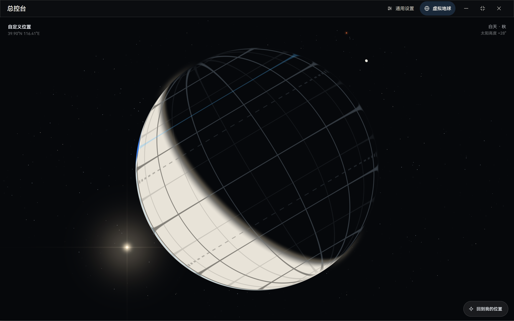
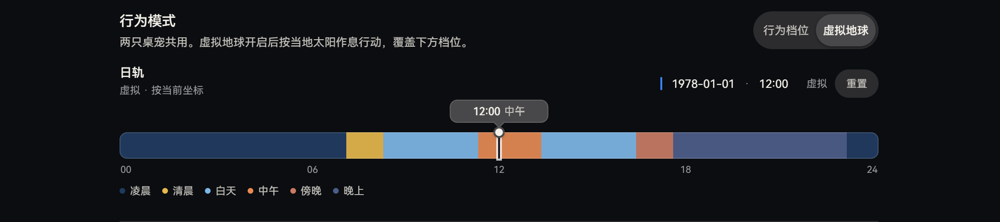

# Lemuel Scamp · 蕾缪乐（能天使 / Exusiai）· 小淘气

[English](README.en.md) · **简体中文**

**明日方舟开源桌宠（非官方）· Arknights desktop pet · Windows 桌面端 · v0.1.0 Preview · [予愿安洁莉娜桌宠（正式名：酸橙味的信）](https://github.com/JNGKZbird/Arknights-Angelina-Pet-YuYuan) 同源技术栈**

**作者**：JNGKZbird

## 摘要

Lemuel Scamp 是一个面向 Windows 的明日方舟开源桌宠（非官方粉丝作品）：能天使与异格「新约能天使」两位干员同屏生活，各自独立移动、显示，也能各自调「偏静 / 标准 / 偏动」三档活跃度。默认按档位自主散步、坐下、打盹；在总控台切到「虚拟地球」后，改由设定地点的太阳位置、日照与极昼极夜安排她们的一天（地球页显示月相；月相不驱动作息）。右键任意一只打开菜单并选「互动」：WASD 接管、Shift 冲刺、F 戳一戳 80px 内的另一只；冰面惯性默认关闭，可在总控台开启。界面支持简体中文与 English。内置移植自官方 spine-ts 3.8 的运行时与自研 WebGL 渲染，Tauri v2 + React 19。语音、LLM 对话、Agent 行为、音游模式与更多皮肤均为路线图，不在本预览版内。

**关键词**：明日方舟、开源桌宠、蕾缪乐、能天使、新约能天使、Spine 3.8、虚拟地球、月相、日轨、互动、桌面宠物、Tauri、Windows

## Abstract

Lemuel Scamp is an unofficial Arknights desktop pet for Windows (v0.1.0 Preview): Exusiai and Exusiai the New Covenant, two operators on one screen, each with independent movement, visibility, and an activity level (Quiet / Standard / Active). By default they walk, sit, and nap on their own; switch the console to Virtual Globe and their day is driven by the configured location's solar position, daylight, polar day/night, and seasonal noon naps (the globe page shows the moon phase; the moon does not drive behavior). Right-click a pet to enter Interaction: WASD takeover, Shift sprint, and F to poke the other pet within 80 px; ice-glide inertia is off by default and can be enabled in the console. The interface supports Simplified Chinese and English. Built on a Spine 3.8 runtime ported from the official spine-ts 3.8 plus a self-made WebGL renderer, Tauri v2 + React 19. Voice, LLM dialogue, Agent behaviors, a rhythm mode and extra skins are roadmap items, not in this preview.

**Keywords**: Arknights, desktop pet, Lemuel Scamp, Exusiai, Exusiai the New Covenant, Spine 3.8, virtual globe, Tauri, Windows, Apache-2.0.

> 预览版状态：程序可运行；首次启动会进入素材安装器，从 GitHub Releases 下载并校验素材包。角色与 Spine 素材不随本仓库分发。本作与《明日方舟》版权方无关。

## 预览



## 她能做什么

- **两位干员同屏**：能天使与新约能天使各自拥有独立的活跃档位、位置与可见性；共享同一套时间与地点。
- **自主生活**：默认按「偏静 / 标准 / 偏动」三档散步、坐下、打盹；档位只调节奏，活动范围始终是当前显示器的工作区（不含任务栏）。
- **虚拟地球作息**：按当地经纬度与太阳位置计算日照、日出日落、极昼极夜与季节午睡；一天分六种时段，各有不同的行为编排。地球页显示月相，月相只作展示。
- **互动接管**：右键任意一只打开菜单，选「互动」进入；WASD 移动、Shift 冲刺、F 戳一戳 80px 内的另一只；Esc 退出互动，回到当前行为模式。
- **中英双语界面**：总控台「通用设置」可在简体中文与 English 之间切换，总控台、虚拟地球页、日轨与右键菜单即时跟随。
- **桌面形态**：透明、无边框、置顶覆盖层；空白区域点击穿透，不占任务栏。

## 操作

| 操作 | 方式 |
| --- | --- |
| 拖动桌宠 | 按住角色拖动 |
| 戳一戳 | 左键短按角色（位移 < 4px 且按住 < 600ms；超过则按拖动处理） |
| 打开菜单 | 右键角色 → 打开主控台 / 互动 / 隐藏 |
| 互动移动 | WASD |
| 冲刺 | Shift（冰面惯性默认关闭，可在总控台开启） |
| 戳另一只 | F（互动中，另一只距离 ≤ 80px） |
| 退出互动 | Esc |
| 显示、隐藏、档位、模式 | 总控台「通用设置」 |
| 界面语言 | 总控台「通用设置」→ 语言 |
| 退出应用 | 关闭总控台窗口（总控台＝软件本体，桌宠一并退出） |

### 已知限制

- 覆盖层只铺当前显示器的工作区；多显示器、混合 DPI、显示器热插拔尚未支持。
- 角色显示高度有 252px 上限，4K 屏上约占屏高 11.7%。
- 没有托盘图标与全局热键，也没有单实例保护（重复启动会出现多套窗口）。两只都隐藏后只能从总控台恢复，关闭总控台即退出应用。
- 不提供安装包与代码签名；从源码构建的产物不得对外分发。
- 语音、LLM 对话、Agent 行为、音游模式、更多皮肤与移动端均为路线图。

## 两种行动方式，一个接管状态

1. **行为档位（默认）**：每只干员独立选择偏静、标准或偏动，按档位自主行动。
2. **虚拟地球（总控台切换）**：两只共用同一地点与时间，按当地太阳作息行动，覆盖档位。

「互动」不是第三套引擎，而是随时可以进入的接管状态：右键 → 互动，操作其中一只；Esc 退出后回到进入前的行为方式。

## 互动：基建式接管

互动模式源于《明日方舟》基建里的互动：右键选中一只干员进入互动，就可以自由操控她走动。两只靠得足够近时（渲染内容的包围盒间隙 ≤ 80px），会出现「F」提示；按 F 触发另一只的戳一戳动画。预览版尚未实装语音。

进入互动会给受控干员套上基建同款的黄色描边（#FFEB04，可在总控台关闭）。官方 PC 端只能用屏幕虚拟摇杆，非触屏电脑则要靠鼠标拖拽，用起来不便；这里改用 WASD 移动、Shift 冲刺。冲刺后松开方向键，只要松手时的速度还在冲刺档位，就会像溜冰一样继续滑一段——这就是溜冰惯性，默认关闭，可在总控台开启。Esc 退出互动，回到原来的行为档位或虚拟地球作息；互动只是接管，不会改档位和模式。

## 虚拟地球



虚拟地球是纯代码绘制的：没有 3D 模型文件，没有地球贴图，也不依赖 three.js 一类的 3D 引擎。整个球面画在一块 canvas 的全屏三角形里，由自研 WebGL1 片元着色器逐像素解析计算；经纬网、晨昏线、太阳与月亮同样由着色器实时画出来，1600 颗星按随机方向生成。每进入一次地球页，星空都会重新随机。整个地球页自身的实现（含样式与着色器）约 93 KB。



- **虚拟太阳与月亮**：太阳位置、日照和晨昏线按当地经纬度与时间计算；月亮有自己的月相，月亮只作展示，不驱动作息。
- **默认北京**：39.9042°N、116.4074°E，让桌宠以北京作息生活。在地球页点位置标记可以改经纬度，设置会保存，用来模拟各地的作息规律。
- **六种时段**：清晨、白天、中午、傍晚、晚上、凌晨，各有不同的行为编排。时段边界由太阳高度决定，随纬度和日期变化；白天被中午分成上下午，凌晨横跨午夜前后，所以日轨上通常看到八段连续色块，但只有六种时段类型。
- **极昼与极夜**：没有日出日落时，作息切成两半——活跃 08:00–20:00、安静 20:00–08:00，各 12 小时。
- **日轨**：可以改虚拟日期和时刻，通过改变一天中的时刻或日期来模拟不同季节的作息环境；点「重置」回到电脑当前时间。
- **彩蛋**：星空里藏了一颗不点名的星，等你自己发现。

预览版的已知限制：地球页暂未附带海岸线数据（`public/globe/map.bin` 不在仓库中），球体、经纬网、太阳、月亮、晨昏线与星空正常显示。海岸线代码路径当前休眠（`ENABLE_COASTLINES = false`），不会发起请求，也不会产生控制台警告。

## 从源码运行

### 前置

- Windows 10/11 x64
- Node.js `^20.19.0` 或 `>=22.12.0`，pnpm
- Rust stable（MSVC 工具链）
- Visual Studio 2022 Build Tools，安装「使用 C++ 的桌面开发」
- WebView2 Runtime（Windows 11 自带；Windows 10 可能需要单独安装）

### 启动

```bash
pnpm install
pnpm tauri dev
```

首次启动会编译 Rust 原生层，需要几分钟；之后是增量编译。

### 角色素材

角色与 Spine 素材不随本仓库分发。**首次启动时**，安装器会从 `trickster-assets-v1` Release 下载 `windows.zip`（975,229 字节），校验整包 SHA-256 后解压到应用数据目录：

```text
%LOCALAPPDATA%\com.jngkzbird.lemuel-scamp\assets\models-v1\
  angel\    6 个文件
  angel2\   3 个文件
```

<https://github.com/JNGKZbird/Arknights-Desktop-Pets-Archive/releases/tag/trickster-assets-v1>

下载失败、代理不通或离线时，可在安装器里选「手动导入官方 zip」，选中同一个 `windows.zip`。文件大小与 SHA-256 必须与内置值一致；非官方包会被拒绝，已安装的素材不受影响。

从源码开发时（`pnpm tauri dev`），若下列文件已放在 `public/models`，程序会直接使用它们并跳过安装器；设置 `LEMUEL_FORCE_ONBOARDING=1` 可忽略这个开发来源，强制走安装流程并改读已安装目录。

```text
public/models/angel/
  build_char_103_angel.atlas
  build_char_103_angel.png
  build_char_103_angel.skel
  build_char_103_angel_white.atlas
  build_char_103_angel_white.png
  build_char_103_angel_white.skel

public/models/angel2/
  build_char_1041_angel2.atlas
  build_char_1041_angel2.png
  build_char_1041_angel2.skel
```

素材仅供个人非商业使用，版权归上海鹰角网络有限公司所有。

### 构建

```bash
pnpm build          # 类型检查 + 前端构建
pnpm tauri build    # 构建安装包（预览版不发布构建产物）
```

`pnpm tauri build` 会先执行 `scripts/check-release-assets.mjs`：只要 `public/models/` 或 `dist/models/` 非空就拒绝构建，避免把游戏素材打进安装包。作者机上这两个目录非空，所以会被拒绝；干净 clone 没有素材目录，会继续打包——但预览版只发布源码，构建产物不得对外分发。发布二进制前，需要确认 `NOTICE.md`、`LICENSES/` 与字体/Spine 许可随包分发（`bundle.resources` 已配置把它们放进安装目录的 `licenses/`）。

## 技术

- Tauri v2（2.12）+ React 19 + TypeScript + Vite 8；Windows WebView2。
- Spine 3.8 骨骼解算：移植自官方 spine-ts 3.8，与予愿安洁莉娜桌宠（正式名：酸橙味的信）的 `spine38` 实现同源；WebGL 渲染器为本项目自研。
- 虚拟地球：一块 canvas、一个全屏三角形与自研 WebGL1 着色器实时绘制球体、经纬网、晨昏线与 1600 颗星，不用 3D 模型、地球贴图或 3D 引擎；太阳与月亮位置由本地天文近似计算。
- 代码规模：本仓库源码（TypeScript/TSX、样式与 Rust，不含字体与游戏素材）约 730 KB，其中约 170 KB 为 `src/spine38/` 的 Spine 3.8 运行时与自研 WebGL 渲染器。
- 当前运行时读取 Spine 3.8 二进制 `.skel` 与单图集页；不直接读取 Live2D `.moc3`，也不是通用模型导入器。
- 产品当前固定两位干员，没有模型导入界面。
- 渲染跟随 `requestAnimationFrame`；物理固定 60Hz，不做固定帧率承诺。

## 路线图（未实装）

以下是规划，不属于当前预览版功能：

- **LLM 对话体系**：基于予愿安洁莉娜桌宠的对话基础，为能天使与新约能天使建立各自的知识库，并内置通用知识库。
- **更复杂的 Agent 行为**：两只桌宠相互闲聊、相互互动；在屏幕中争夺视觉焦点；特定条件下抢夺鼠标；加入虚拟光标与虚拟键盘行为。最终为软件构建出简单的 Harness 体系。
- **音游模式（考虑中）**：每只桌宠拥有若干套独特的音色；能天使的 808 牛铃音效已经做好。
- **更多皮肤（远期）**：能天使的三套皮肤与新约能天使的一套皮肤。
- **移动端（远期）**：Windows 预览版之后，移动端先做 HarmonyOS——手机版与平板版分开设计与发布，鸿蒙版为先行版；随后再做 Android。

## 许可与来源

- **本项目原创代码**：Apache-2.0，见 [LICENSE](LICENSE)。
- **`src/spine38/`**：官方 spine-ts 3.8 的衍生/集成，按 Spine Runtimes License 使用，**不是 Apache-2.0**。本项目持有有效的 Spine Editor 许可（Spine Essential）；终端用户直接使用无需购买；第三方原样分发须保留 2025 版许可原文；修改、适配或衍生需要自己的 Spine Editor 许可。原文见 [LICENSES/](LICENSES/)。
- **内置字体**：HarmonyOS Sans SC（华为官方 5.0.1 安装包中的可变字体，未修改），版权归华为，按 HarmonyOS Sans 字体许可使用；许可见 [LICENSES/HarmonyOS-Sans-Fonts-License.txt](LICENSES/HarmonyOS-Sans-Fonts-License.txt)。
- **予愿安洁莉娜桌宠（正式名：酸橙味的信）**：其原创、且位于 `spine38/` 之外的代码为 MIT；本仓库未复制该部分代码。本作是独立的 Windows/Tauri 实现，同源技术栈上的一次全新尝试。
- **游戏素材**：《明日方舟》角色、Spine 模型、贴图等版权归上海鹰角网络有限公司所有，不适用上述任何许可，也不随本仓库分发；仅供个人非商业使用。权利方如提出要求，应停止分发并删除相关内容。
- **非官方声明**：本项目与上海鹰角网络有限公司、Esoteric Software 均无官方合作或背书关系。

完整的第三方许可与分发边界见 [NOTICE.md](NOTICE.md)。

## 开发文档

`docs/` 收录开发期的调研与设计档案，沿用项目代号「捣蛋鬼计划」。仓库只跟踪 Markdown、SVG 与 JSON 源文件；导出的 PNG、PDF、HTML 不跟踪。档案中的旧路径与旧名称不代表当前发布名。

## 致谢

- [予愿安洁莉娜桌宠（正式名：酸橙味的信）](https://github.com/JNGKZbird/Arknights-Angelina-Pet-YuYuan)：同源 Spine 3.8 技术栈与素材档案库。
- [Esoteric Software](https://esotericsoftware.com/)：Spine 与官方 spine-ts 运行时。
- [华为 HarmonyOS Sans](https://developer.harmonyos.com/)：内置字体。
- Tauri、React、Vite 与所有依赖的维护者。
