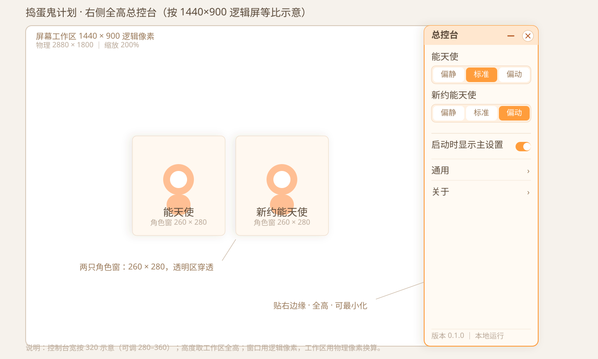
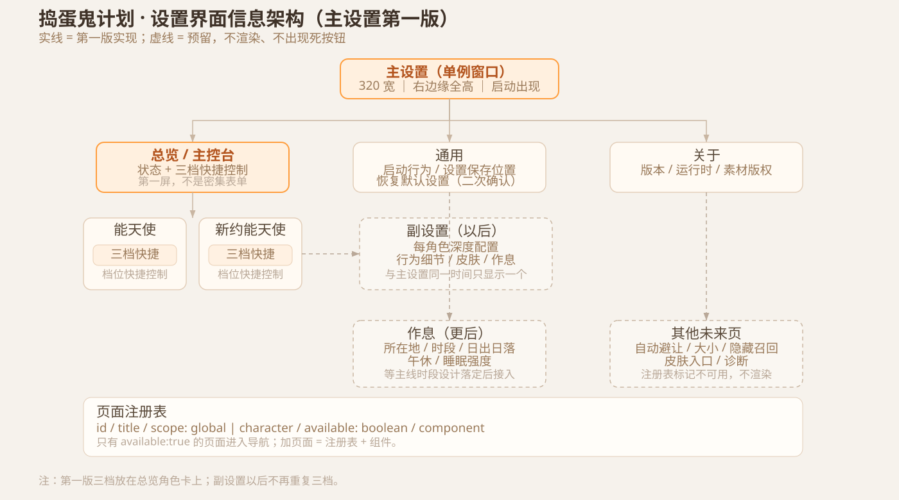

# 捣蛋鬼计划 · 设置界面骨架调研——主控台与主/副设置分层

> **设计调研报告** ｜ 2026-10-17 ｜ 署名：JNGKZbird
>
> 性质：**方案调研 + 形态口径已定** ｜ 本轮**不写代码** ｜ 范围：主设置界面骨架（副设置界面、时段/太阳逻辑不在本轮）
>
> 输入：用户 2026-10-17 晚构想（设置随桌宠同步出现、主设置 + 两角色副设置）＋ 桌面委托书《捣蛋鬼计划-设置界面骨架-委托书.md》＋ 当前代码审计。
>
> **口径修订（2026-10-17 晚）**：用户拍板——平台维持 Windows；交互体验向 **HarmonyOS NEXT（纯血鸿蒙）** 靠拢；主设置定为**贴右边缘、全高总控台侧栏**，宽度**默认 320vp、可调 280–360vp**；此前“高:宽 = 16:9 浮窗”方案作废。

---

## 0. 摘要（先看这页）

- 你的“主设置 + 每角色副设置”分层**成立**，与 VPet 的“软件设置 / 游戏设置”、系统设置 / 应用设置是同一类结构。
- 但“每次启动直接弹出完整设置表单”在传统桌面软件里是反模式。你的构想更接近**伴随式主控台（Control Center）**：自动出现的第一屏应是**总览**，设置分类从总览进入，而不是一屏表单。
- 形态已定：**贴屏幕右边缘、全高**的总控台侧栏；宽度**默认 320vp、可调 280–360vp**，高度取当前显示器工作区全高。此前的 16:9 浮窗方案作废。
- 尺寸按鸿蒙口径：看**窗口宽度 vp**而非物理分辨率；<600vp 改覆盖层，600–839vp 用 240vp，840–1439vp 用 `clamp(280, 25%, 320)`，≥1440vp 用 `clamp(320, 25%, 360)`。本机 1440×900 逻辑屏默认 320vp（22.2%宽）。
- 交互语言按 **HarmonyOS NEXT（纯血鸿蒙）** 落地：大圆角、卡片、48vp 热区、柔和缓动、单栏页栈、最小化到任务栏；不搬 ArkUI 专属控件与官方素材。
- 主设置应是**独立、正常可交互的窗口**：现有 `lib.rs` 的 8ms 轮询会把没有命中框的窗口默认设为穿透，设置窗必须加白名单例外，否则点不到。
- 持久化建议改用 Tauri 官方 `@tauri-apps/plugin-store`：单一 JSON、跨窗 `onKeyChange`、带版本与迁移；localStorage 只作为三档的迁移来源。
- 三档建议作为**总览角色卡上的快捷控制**迁移进主设置；每角色的深度项留给以后的副设置。这样主界面一出现就有实际作用，也符合“快捷控制 vs 深度设置”的分层。
- 未实现页面在页面注册表里标 `available: false`，**不渲染**，不出现死按钮。
- 已定：Windows 平台 + 鸿蒙交互语言；右边缘全高侧栏；320 默认、280–360 可调；标准窗口最小化到任务栏；三档作为总览快捷控制；主设置先做、副设置后做。仍需定：启动展开状态、页面内容细节、字体引入。

---

## 1. 任务与约束

### 1.1 用户的新构想

1. 每次新打开桌宠后，设置界面与桌宠**同步出现**；
2. 有两种设置界面：**正式的主设置界面** + **两个桌宠的副设置界面**；
3. 先做**主设置界面**；
4. 主设置界面**优先出现在屏幕右上角**；
5. **高:宽 = 16:9**。

这套构想的关键不是“做一个设置页”，而是**设置成为陪伴体验的一部分**：它随桌宠一起出现，位置固定，像一块随桌宠一起上班的主控台。它和传统“文件 → 首选项”的设置窗不是同一种东西。

### 1.2 项目现状（代码审计）

| 事实 | 位置 | 对设置界面的影响 |
|---|---|---|
| Tauri v2 + React 19 + TS + pnpm；Tauri API 2.12.4 | `package.json` + `node_modules` | 可用官方 window/store 插件 |
| 双窗平权：入口窗 `angel2`，拉起 `angel`；同一 App 用 `?char=` 区分 | `src/App.tsx` | 设置需支持两窗打开、单例 |
| 角色窗 260×280，透明、无边框、置顶、无任务栏、不可缩放 | `src-tauri/tauri.conf.json` | 设置窗应是另一种窗口配置 |
| 点击穿透：Rust 8ms 轮询，所有窗口按命中框判定 | `src-tauri/src/lib.rs` | 新窗口必须登记命中框或加白名单 |
| 未登记命中框的窗口默认 `ignore=true` | `src-tauri/src/lib.rs` | 设置窗不加例外会被穿透，点不到 |
| capabilities 只列 `angel2` / `angel` | `src-tauri/capabilities/default.json` | 新窗口 label 必须加入 |
| 三档存 localStorage：`pet-gear-angel` / `pet-gear-angel2`，每窗独立 | `src/App.tsx` | 需迁移；当前无跨窗同步 |
| 右键菜单只能落在角色身上（OS 级穿透导致） | `src/App.tsx` + `lib.rs` | 长按/右键入口受系统手势影响 |
| Esc 在菜单关闭时会关掉整个角色窗 | `src/App.tsx` | 设置窗不能继承此行为 |
| 无路由、无 store 插件、无组件库、无字体资源 | `package.json` | 需要自建轻量结构 |
| 本机逻辑屏 1440×900，物理 2880×1800，200% 缩放 | PowerShell 实测 | 窗口尺寸/坐标用逻辑像素，屏幕工作区用物理像素换算 |

### 1.3 本轮边界

本报告只讨论**主设置界面骨架**。以下不在本轮：时段/太阳算法、午休状态机、行为调度改动、皮肤、FNF、Agent、召唤、光标关注、抢鼠标、自动避让实装、隐藏/召回、四向移动、坐/睡裁切 bug、任何行为层参数调整。

---

## 2. 专业设置界面怎么做

### 2.1 信息架构的共性

跨 Windows、macOS、HarmonyOS、Material 的调研，结论高度一致：

- **设置是一等目的地**，不是一个塞满东西的弹窗；
- **按用户目标分组**，不按内部模块分组；
- **渐进披露**：常用项在前，低频项进二级页或展开区；
- **导航要可增长**：纵向导航/列表比横向标签更能扩展；
- **同一屏只用一种保存模型**；
- **不出现点了没反应的死按钮**。

### 2.2 各平台的具体规范

| 平台 | 关键规范 | 对本项目的启示 |
|---|---|---|
| **Windows（WinUI）** | 设置入口固定在 NavigationView 底部；设置页全页体验；内容区最大宽约 1000–1100；用 SettingsCard / SettingsExpander 分组；改动即时生效；About 放底部 | 360 宽不能照搬 1000px；但“分组卡片、即时生效、About 置底”适用 |
| **macOS（HIG）** | 设置窗 modeless；无保存/取消/应用；工具栏“图标 + 文字”；General 首、Advanced 尾；记住上次页 | 设置窗不应是模态弹窗；改动立即生效；不应打断桌宠 |
| **HarmonyOS** | Navigation 的 Stack / Split / Auto；小于 520vp 单栏，达到 520vp 分栏；卡片点击直达目标页 | 360 宽必须单栏；首页卡片 → 二级页 |
| **Material / Android** | 最小 48dp 触控目标；列表-详情；小窗单栏、大窗双栏；600dp 左右分界 | 本项目取 44–48 CSS px；行高 56 左右 |
| **通用设置 UX** | 纵向导航更易扩展；按目标分组；渐进披露；危险操作隔离 | 页面注册表 + 分组卡片 |

### 2.3 触控尺寸

- Windows 官方建议触控目标约 **40×40**（7.5mm，135 PPI）；
- Material 建议最小 **48×48dp**，控件间约 8dp；
- 本项目是触屏优先，建议取 **44–48 CSS px**，主按钮 52–56 高；
- **不要只靠 hover**：所有交互都要有按下反馈；设置面板内部不需要长按；
- 辅助文字不要低于 12px；正文 14–15px。

### 2.4 保存模型

- 开关、单选项：**即时生效**，给轻量反馈；
- 多字段表单：显式保存 + 未保存提示；
- 不要在同一屏混用“自动保存”和“保存按钮”；
- 危险操作（恢复默认、删除数据）单独隔离并二次确认。

本项目第一版几乎全是开关/单选项，建议**统一即时生效**，不设“保存/取消”。

### 2.5 “每次启动自动出现”怎么处理

标准桌面 UX 的结论是：**不要每次启动都弹设置**。优先给好默认值；需要配置时只做一次首次引导；之后靠常驻入口进入。

但这条结论针对的是传统“设置表单”。你的构想是**伴随式面板**，属于另一类：控制中心/仪表盘。专业上可以接受自动出现，但要满足：

- 第一屏是**总览**，不是密集表单；
- **不抢焦点**（`focus: false`），不打断用户正在做的事；
- 有**启动时显示**开关，默认开；
- 关闭后仍有明确的再打开路径；
- 动效安静，不做持续动画；
- 2 秒内能看懂这屏在说什么。

这与 Calm Technology 的原则一致：信息停留在边缘注意力，需要时才进入中心；不持续索取注意。

---

## 3. 同类桌宠/伴随应用怎么做

| 产品 | 设置形态 | 可借鉴点 |
|---|---|---|
| **VPet 虚拟桌宠模拟器** | 右键角色菜单 + 多个独立窗口：`winSetting` 软件设置、`winGameSetting` 游戏设置；分类有图形/系统/互动/自定/诊断/MOD | **主设置/副设置分层有先例**：软件级与角色/游戏级分开 |
| **Desktop Pet** | 托盘菜单 + 完整控制面板，分 Rules / Display / System；有穿透警告、重置位置 | 必须留恢复入口；点击穿透是高风险项，要讲清楚 |
| **BongoCat（Tauri）** | 透明桌宠窗口 + 独立 preference 窗口，默认隐藏，从托盘或快捷键打开；两窗口共用同一 Vue 应用、不同路由；用 tauri-store/Pinia 持久化 | 与我们的技术栈最接近：**overlay 与设置窗分离、设置窗永不带穿透、单例复用、跨窗共享状态** |
| **Shimeji** | 以托盘/右键菜单为主，设置很轻 | 轻量桌宠可以没有完整设置；但功能一多就需要正式面板 |
| **Desktop Mate** | 设置信息少，MOD/VRM 安装摩擦被用户抱怨 | 正式设置界面本身就是体验加分项；安装/资产入口要清楚 |

共性结论：

1. **桌宠本体窗口 ≠ 设置窗口**；
2. 一般是“轻量快捷菜单 + 完整面板”两层；
3. 设置窗口正常可交互，**永远不参与点击穿透**；
4. 必须有恢复路径（托盘/右键/任务栏）；
5. 状态跨窗共享，否则会出现“主面板改了、桌宠没变”。

---

## 4. 形态判断：这不是传统设置窗

### 4.1 主设置 = 伴随式主控台

把四个特征放在一起看：

- 每次启动自动出现；
- 固定屏幕位置；
- 固定比例；
- 与桌宠同步出现。

这些特征组合出来的是**仪表盘/控制中心**，不是传统设置窗口。传统设置窗口通常按内容自适应大小、记住位置、从菜单进入、不自动弹出。

因此建议把“主设置”定义为：

> **桌宠的主控台**：第一屏是总览（两只桌宠的状态与快捷控制），设置分类从总览进入；低频的深度配置放二级页。

这样既保留你要的“和桌宠一起出现”的仪式感，也符合专业产品对“设置”与“控制中心”的分层。

### 4.2 主设置与副设置的分工

| 层级 | 定位 | 内容 | 打开方式 |
|---|---|---|---|
| **主设置** | 应用级 + 快捷控制 | 启动行为、全局选项、两只桌宠的档位快捷控制、关于 | 启动自动出现；右键角色菜单 |
| **副设置**（以后） | 每角色深度配置 | 角色专属行为细节、皮肤、作息偏好等 | 从主设置的角色卡进入；或右键角色 |
| **时段/太阳**（更后） | 全局作息 | 所在地、时段、日出日落、午休、睡眠强度 | 主设置内的分类页 |

这与 VPet 的 `winSetting`（软件）与 `winGameSetting`（游戏/角色）分层一致。

### 4.3 快捷控制 vs 深度设置

控制中心与完整设置的关系，专业上有一个成熟做法：

- 控制中心放**高频、单项、即时**的操作；
- 完整设置放**低频、组合、需要解释**的配置；
- 两边**不要重复编辑同一个值**；如果必须重复，必须实时同步。

本项目第一版可以实现为：

- 主设置总览的角色卡上放**三档快捷切换**（高频、单项、即时）；
- 副设置以后只放更深的每角色参数，不再重复三档；
- 这样既完成现有三档迁移，又避免以后出现两个地方改同一个值。

### 4.4 推荐结论

**推荐**：主设置先做成“总览 + 通用 + 关于”的伴随式主控台；三档作为总览角色卡上的快捷控制迁移进来；副设置以后按角色拆出。若你坚持“主设置只做全局”，三档可暂留右键菜单，但主设置首版内容会偏薄。

---

## 5. 形态、尺寸与版式（定稿口径）

### 5.1 形态定稿：右侧全高侧栏

用户 2026-10-17 晚拍板，**推翻此前的 16:9 浮窗方案**：

- 主设置不是浮窗，而是**贴屏幕右边缘、全高**的总控台侧栏；
- 宽度**默认 320vp**，可调范围 **280–360vp**；
- 高度取当前显示器**工作区全高**；
- 交互体验向 **HarmonyOS NEXT（纯血鸿蒙）** 靠拢，而不是 Windows 设置窗口风；
- 平台仍是 Windows（Tauri），暂不做跨 OS 移植。

16:9 的比例约束不再适用于窗口本身。侧栏的“比例”由屏幕工作区高度决定；如果需要固定比例，只应作用在内部某张卡片上，而不是窗口。

### 5.2 宽度怎么定：鸿蒙断点 + clamp

鸿蒙官方以**窗口宽度 vp**为准，不看物理分辨率；Windows/Tauri 的逻辑像素可视为 vp 等价单位。

官方断点（窗口宽度）：xs < 320vp；sm 320–600；md 600–840；lg 840–1440；xl ≥ 1440vp。设置页在 <600vp 单栏，≥600vp 可 4:6 分栏（导航约 240 / 内容约 360）；常驻侧边导航建议 ≥840vp。`SideBarContainer` 默认 `sideBarWidth` 240vp、上限 280vp；`Navigation` 默认左栏 240vp、内容最小 360vp。

本项目总控台比“导航栏”更宽（要放触屏角色卡、三档控件、未来作息卡），因此沿用同一套断点方法，但放宽宽度：

| 窗口逻辑宽度 | 控制台宽度 | 说明 |
|---|---|---|
| < 600vp | 不常驻 | 改为覆盖层/抽屉，避免吃掉一半屏幕 |
| 600–839vp | 240vp | 设置页分栏的下限口径 |
| 840–1439vp | `clamp(280, 25% × 宽度, 320)` | 1024→280；1280→320 |
| ≥ 1440vp | `clamp(320, 25% × 宽度, 360)` | 1440→360；1920/2560 封顶 360 |

简化规则（宽度 ≥840vp）：**控制台宽 = clamp(280vp, 25% × 窗口宽, 360vp)**，默认落在 320vp；允许用户在 280–360 之间调整。若严格贴鸿蒙 `SideBarContainer` 的 280vp 上限也可以，但三档控件要改竖排，触屏余量更紧。

### 5.3 本机屏幕与坐标

| 项目 | 数值 |
|---|---|
| 逻辑分辨率 | 1440×900（Windows 工作区同尺寸） |
| 物理分辨率 | 2880×1800 |
| 缩放 | 200% |
| 默认控制台宽度 | 320 逻辑像素（占屏宽 22.2%） |
| 贴右边缘时窗口位置 | `x = 1440 − 320 = 1120`，`y = 0`，`height = 900` |
| 可调上限 360 时 | `x = 1080`，仍全高 |

注意 Tauri 的坐标系：

- `Monitor.position` / `Monitor.size` / `Monitor.workArea` 是**物理像素**；
- `WebviewWindow` 的 `x / y / width / height` 是**逻辑像素**；
- 200% 缩放下必须用 `scaleFactor` 换算，否则会跑到屏幕外或尺寸翻倍；
- 多屏时用**目标显示器自己的** `workArea` 与 `scaleFactor`，不要用主屏值代替。



### 5.4 全高总览线框（默认 320）

```text
┌──────────────────────┐
│ 总控台        —   ✕  │  48px 顶栏；最小化/关闭
├──────────────────────┤
│ 能天使                │
│ [偏静][标准][偏动]    │  触屏 48px
│ 新约能天使            │
│ [偏静][标准][偏动]    │
│                      │
│ 启动时显示主设置  ●  │
│ 通用               › │
│ 关于               › │
│                      │
│                      │  ← 全高，内容顶部对齐
│                      │
│ 版本 0.1.0           │  底部状态
└──────────────────────┘
      贴右边缘 · 全高
```

### 5.5 二级页线框

```text
┌──────────────────────┐
│ ‹ 通用        —   ✕  │
├──────────────────────┤
│ 启动                  │
│ 启动时显示主设置  ●  │
│                      │
│ 数据                  │
│ 设置保存位置      ›  │
│ 恢复默认设置      ›  │
│                      │
│                      │
│                      │
│                      │
│ 版本 0.1.0           │
└──────────────────────┘
```

### 5.6 触控与尺寸规范

| 项目 | 建议值 |
|---|---|
| 窗口 | 宽 320（280–360 可调），高＝当前屏工作区全高 |
| 窗口行为 | 常规窗口；可最小化到任务栏；单例 |
| 顶栏 | 48px；最小化/关闭键各 44×44 |
| 外边距 | 16px；贴右边缘 |
| 列表行高 | 56px |
| 最小触控目标 | 48×48；次要图标不小于 44×44 |
| 正文字号 | 14px；辅助 12–13px；标题 18–20px |
| 图标 | 20–24px，线性图标 |
| 圆角 | 卡片 16–20px；按钮 12px（鸿蒙式大圆角） |
| 行距 | 1.5–1.6 |
| 控件间距 | 8–12px；分组间距 20–24px |

### 5.7 “纯血鸿蒙”在 Windows 上具体指什么

不是把 ArkUI 控件搬到 Windows，而是把**交互语言与设计规范**落成 Windows 可执行的做法：

- **布局**：大圆角、卡片化、充足留白、单栏页栈；避免 Windows 设置页的密集列表感；
- **触控**：48vp 热区、明显的按下态、不依赖 hover；长按不作为唯一入口；
- **动效**：200–300ms 的柔和缓动/轻弹性；只做淡入、位移、缩放反馈，不做持续动画；尊重“减少动态效果”；
- **层次**：柔和的表面色、轻阴影、清晰的标题/正文/辅助三级字号；用 HarmonyOS Sans SC；
- **导航**：二级页有明确的返回按钮，同时保留 Esc；系统级边缘手势与 Windows 冲突的，不强行模拟；
- **窗口**：像窗口一样可最小化到任务栏、可恢复；不做无任务栏的“藏起来”式边条；
- **不搬**：ArkUI 专属控件、鸿蒙系统素材、官方角色素材；只仿交互与设计语言。

第一版的视觉目标是“看起来像一个鸿蒙生态的桌面总控台”，而不是“Windows 设置窗换了个皮”。

---

## 6. 信息架构

### 6.1 主设置（第一版）

```text
主设置
├── 总览
│   ├── 能天使      档位快捷切换
│   ├── 新约能天使  档位快捷切换
│   └── 启动时显示主设置（或移到通用）
├── 通用
│   ├── 启动行为
│   ├── 设置保存位置（只读）
│   └── 恢复默认设置（危险区，二次确认）
└── 关于
    ├── 版本
    ├── 运行时（Tauri / WebView2）
    └── 素材版权说明
```

**第一版不出现**：作息、时段、太阳、所在地、午休、自动避让、大小、隐藏/召回、皮肤、角色深度设置。它们只存在于页面注册表中，标记为不可用，不渲染。



### 6.2 副设置（以后）

- 每个角色一个深度设置界面；
- 从主设置的角色卡进入；
- 内容示例：角色专属行为细节、皮肤、作息偏好；
- 不重复三档快捷控制，避免双写；
- 与主设置同一时间只显示一个设置面（委托书要求）。

### 6.3 页面注册表

建议用一份显式注册表驱动导航，而不是把分类写死在 JSX：

```ts
type SettingsPage = {
  id: string;
  title: string;
  scope: "global" | "character";
  available: boolean;
  icon?: string;
  component: React.ComponentType;
};
```

- 只有 `available: true` 的页面进入导航；
- 未来加页面 = 注册表加一项 + 对应组件；
- 「不显示未实现的死按钮」由 `available` 控制，而不是靠注释。

### 6.4 导航形态

- 控制台宽度 280–360：**始终单栏列表 → 二级页**；顶栏左侧返回，右侧最小化/关闭；
- 不因为屏幕变宽而改成双栏——控制台本身始终保持窄栏，屏幕宽度只决定侧栏宽度档位；
- 记住上次页可作为后续优化；第一版每次启动回到总览，更符合“主控台”定位；
- 主设置与副设置同一时间只显示一个设置面。

---

## 7. 持久化与双窗同步

### 7.1 三种方案对比

| 方案 | 优点 | 缺点 | 结论 |
|---|---|---|---|
| **localStorage + storage 事件** | 零依赖、改动小 | WebView2 同源跨窗是否同步需实测；不是权威存储；迁移/版本管理弱 | 不推荐作为最终方案 |
| **Tauri plugin-store** | 官方插件；单一 JSON；跨窗 `onKeyChange`；Rust 与前端共享 | 需加依赖与 capability；默认值由首个创建者决定 | **推荐** |
| **Rust 侧自建配置 + 广播事件** | 完全可控；适合复杂迁移 | 代码更多；需要自己实现事件与校验 | 备选；当前规模不必 |

推荐 `@tauri-apps/plugin-store`（当前 npm 2.5.0）。它正好解决现在“两个角色窗各自读 localStorage、互不同步”的问题。

### 7.2 数据结构

```ts
type Gear = "quiet" | "standard" | "active";

type AppSettings = {
  schemaVersion: 1;
  general: {
    showMainOnLaunch: boolean;   // 默认 true
  };
  characters: {
    angel:  { gear: Gear };
    angel2: { gear: Gear };
  };
  // 未来预留（不渲染、不写入死值）
  // schedule?: { location?: { lat: number; lon: number }; ... }
};
```

建议按 key 粒度存储（例如 `general.showMainOnLaunch`、`characters.angel.gear`），这样 `onKeyChange` 只通知真正变化的键，减少全量覆盖冲突。

### 7.3 迁移三档

1. 每个角色窗启动时读取自己的 `pet-gear-angel` / `pet-gear-angel2`；
2. 若 store 中对应 key 不存在，则写入 localStorage 的值；
3. 两窗各自迁移自己的 key，天然幂等；
4. 旧 localStorage key **先保留**，不删除，作为一次性备份；
5. 迁移完成后，所有读写以 store 为准；角色窗订阅 `onKeyChange` 实时更新。

### 7.4 默认值与损坏兜底

- 默认档位：`standard`；
- `showMainOnLaunch`：默认 `true`（按你的构想）；
- 读取时校验枚举值，非法值回退默认；
- store 文件损坏时：保留原文件副本，回退默认值并提示（不要静默清空）；
- 不需要联网，不存任何密钥。

---

## 8. 窗口与点击穿透

### 8.1 独立窗口

- label：`settings`（副设置以后用 `settings-angel` / `settings-angel2`）；
- 尺寸：宽 320（280–360 可调），高＝当前显示器工作区全高；贴右边缘；
- 全高、无边框自绘，48px 顶栏；
- `alwaysOnTop: true`；`minimizable: true`；`skipTaskbar: false`；
- 顶栏提供 44×44 的最小化与关闭；最小化调用 `window.minimize()`，从任务栏恢复；
- 启动时 `focus: false` 显示；用户主动打开时再聚焦；
- 单例：两宠都能打开，已存在则显示/聚焦；
- 关闭行为：销毁并在需要时重建（或隐藏；需拍板）。最小化不销毁，保留当前页状态。

### 8.2 穿透白名单

在 `src-tauri/src/lib.rs` 的轮询中，给设置窗加例外：

```rust
const ALWAYS_INTERACTIVE: &[&str] = &["settings"];

// 轮询循环内
if ALWAYS_INTERACTIVE.contains(&label.as_str()) {
    if last.get(&label).copied() != Some(false) {
        let _ = win.set_ignore_cursor_events(false);
        last.insert(label, false);
    }
    continue;
}
```

这样设置窗永远可交互，不依赖前端每帧推命中框；角色窗的透明区穿透逻辑完全不动。

### 8.3 capabilities

- `windows` 加入 `settings`；
- 加入 `store:default`；
- 加入 `core:window:allow-minimize`（顶栏最小化按钮）；
- 如需从菜单聚焦已有设置窗，再加 `core:window:allow-set-focus`；
- 不需要给设置窗开 `set-ignore-cursor-events` 权限（Rust 侧直接控制）。

### 8.4 生命周期

- 启动流程：`angel2` 创建 `angel`，并创建/显示 `settings`；
- HMR 或重复调用时先查 `getAllWebviewWindows()`，避免重复窗口；
- 两只角色窗都关闭后，应用应退出；不要让一个隐藏的设置窗单独把进程吊住；
- 若设置窗保持打开而两只桌宠都关了，可提示或直接关闭设置窗退出；
- 恢复路径：最小化 → 任务栏恢复；关闭 → 右键角色菜单“打开主设置”；
- 最小化只保留任务栏按钮，不再自动弹回；下次启动仍按“启动时显示”设置出现。

### 8.5 窗口外观选择

| 方案 | 优点 | 缺点 |
|---|---|---|
| **无边框自绘（推荐）** | 与鸿蒙式大圆角/卡片一致；顶栏可做 48px、最小化/关闭各 44px，触屏友好；可自定义左侧圆角 | 拖动、最小化、关闭、焦点要自理；需测试 Win11 圆角/阴影 |
| **系统标准窗口** | 熟悉、无障碍好、实现省事 | 标题栏按钮偏小；与鸿蒙式语言不统一 |

建议第一版用无边框自绘、贴右边缘全高：左边缘做 16–20px 圆角与轻阴影，右/上/下贴边；顶栏作为拖动区域，放最小化与关闭；底部状态区固定。Esc 在二级页返回、在总览最小化或关闭（需定）。

---

## 9. 视觉与交互规范

### 9.1 视觉（鸿蒙式）

- 沿用现有暖白/橙色系，但表面与层次按 HarmonyOS NEXT 处理：背景白色或 96% 白，主色 `#ff9d3c`，强调 `#b3541e`，正文 `#5a4a3a`，次要 `#9a7a5a`；
- 大圆角（卡片 16–20px）、充足留白、轻阴影；分组优先用留白与细分隔线，不堆重边框卡片；
- 字体：HarmonyOS Sans SC（Regular / Medium / Bold），资产可从可露希尔工程引入，需你确认；
- 当前菜单的 10–11px 小字、8px 内边距不适合触屏，控制台整体放大；
- 动效：200–300ms 柔和缓动/轻弹性；只做淡入、位移、缩放反馈，不做持续动画；尊重“减少动态效果”。

### 9.2 交互

- 所有可点区域有按下态（轻微缩放/亮度变化），不依赖 hover；
- 开关/分段控件即时生效，不做“保存/取消”；
- 危险操作二次确认；
- 二级页有明确的返回按钮，同时保留 Esc；系统级边缘手势与 Windows 冲突的，不强行模拟；
- 顶栏最小化/关闭各 44×44；最小化到任务栏；
- Tab 焦点顺序自然，焦点环清晰；
- 滚动只保留一个纵向滚动区，不做嵌套滚动；
- 长按/右键只作为**打开设置**的入口，不用于设置内部操作。

---

## 10. 分阶段实施建议

### 阶段 1（本次委托范围）

- 独立总控台骨架（单例、贴右边缘全高、宽 320 默认/280–360 可调、无边框、穿透白名单）；
- 标准窗口最小化：顶栏最小化到任务栏，任务栏可恢复；
- 启动自动显示、不抢焦点；右键角色菜单增加“打开主设置”；
- 总览 + 通用 + 关于；
- 三档快捷控制迁移到总览角色卡；
- plugin-store + 三档迁移 + 双窗同步；
- 页面注册表与未来插槽（不渲染死按钮）；
- 鸿蒙式视觉令牌（圆角、48vp 热区、200–300ms 动效、HarmonyOS Sans SC）；
- `tsc` / `pnpm build` / `cargo build` 通过。

### 阶段 2

- 每角色副设置界面；
- 与主设置互斥显示；
- 深度行为项、皮肤入口（皮肤接入本身另立任务）；
- 桌宠多屏自适应：按当前显示器工作区与实时 `scaleFactor` 计算活动范围、缩放与拖拽边界；跨屏、竖屏、拔插显示器安全回退。

### 阶段 3

- 时段/太阳/所在地/午休页面；
- 按主线对话的作息设计接入；
- 自动避让、大小、隐藏/召回等设置项。

---

## 11. 风险与待拍板

### 11.1 主要风险

| 风险 | 说明 | 对策 |
|---|---|---|
| 自动弹出打扰 | 每次启动出现全高侧栏 | 总览化、不抢焦点、可最小化、默认开但可关 |
| 全高遮挡 | 320–360 宽的全高面板会长期占用右边缘 | 标准窗口最小化到任务栏；后续可加“启动时最小化”设置 |
| 置顶遮挡 | 始终置顶会盖住右侧内容 | 提供最小化/关闭；后续可加“置顶”开关 |
| 多屏 | 主屏/副屏、DPI 不一致 | 第一版按目标屏工作区；桌宠多屏适配放阶段 2 |
| 穿透 | 设置窗被 8ms 轮询设为穿透 | Rust 白名单，不依赖前端命中框 |
| 双窗同步 | 现在 localStorage 不同步 | plugin-store + onKeyChange |
| 进程生命周期 | 设置窗隐藏导致应用不退出 | 销毁重建；最后一只角色窗关闭时退出 |
| 触屏长按 | Windows 长按右键受系统设置/驱动影响 | 不把长按当唯一入口；自动出现 + 右键/任务栏 |
| 320 宽内容密度 | 三档控件与长标签偏紧 | 320 为默认，允许 280–360；必要时三档改竖排 |
| 鸿蒙风格落地 | 只做“像”，不做 ArkUI 控件搬运 | 设计令牌 + 自研组件；素材与代码分离 |

### 11.2 仍需拍板

已定：Windows 平台；HarmonyOS NEXT 交互语言；右侧全高侧栏；宽度 320 默认、280–360 可调；标准窗口最小化到任务栏；主设置先做、副设置后做；三档放进总览角色卡，副设置不再重复。

仍需定：

1. **启动时的展开状态**：每次启动都展开，还是记住上次“展开/最小化”？
2. **关闭行为**：顶栏关闭是销毁窗口，还是隐藏并从右键菜单恢复？
3. **字体**：确认从可露希尔工程引入 HarmonyOS Sans SC 三字重？
4. **宽度调整方式**：第一版固定 320、只预留设置项，还是直接做拖动/档位选择？

---

## 12. 附录

### 12.1 代码审计要点

- `src/App.tsx`：三档读写 localStorage（约 48–57 行）；右键菜单（约 389–415 行）；Esc 关闭角色窗（约 63–72 行）。
- `src-tauri/src/lib.rs`：命中框接收（12–17 行）；8ms 轮询与默认穿透（30–65 行）。
- `src-tauri/capabilities/default.json`：窗口列表只有 `angel2` / `angel`（第 5 行）。
- `src-tauri/tauri.conf.json`：入口窗 260×280、透明、置顶、无任务栏（13–29 行）。
- 本机屏幕：1440×900 逻辑像素、2880×1800 物理、200% 缩放（PowerShell 实测）。

### 12.2 调研来源

- [Windows 应用设置指南](https://learn.microsoft.com/zh-cn/windows/apps/design/app-settings/guidelines-for-app-settings)
- [Windows NavigationView](https://learn.microsoft.com/en-us/windows/apps/develop/ui/controls/navigationview)
- [Windows 触控目标尺寸](https://learn.microsoft.com/en-us/windows/apps/develop/input/guidelines-for-targeting)
- [macOS HIG Settings](https://developer.apple.com/design/human-interface-guidelines/settings)
- [macOS 设置窗口实践](https://zenn.dev/usagimaru/articles/b2a328775124ef)
- [HarmonyOS 设置页自适应导航](https://gitcode.net/openharmony/docs/-/blame/0a09d3af9617b321d1dbd81bae405e5371fea5cf/zh-cn/application-dev/key-features/multi-device-app-dev/settings-application-page.md)
- [HarmonyOS Design](https://developer.huawei.com/consumer/en/design/)
- [Material 列表-详情布局](https://developer.android.google.cn/develop/ui/compose/layouts/adaptive/list-detail?hl=en)
- [Android 触控目标](https://support.google.com/accessibility/android/answer/7101858?hl=en)
- [Untitled UI 设置页设计](https://www.untitledui.com/components/settings-pages)
- [Calm Technology 原则](https://github.com/phazurlabs/sumi/blob/main/skills/ambient-calm-zero-ui/references/calm-technology-principles.md)
- [Fitts 定律与屏幕边缘](https://github.com/Deibler/universal-design-principles/blob/main/plugins/interaction-and-control-principles/skills/fitts-law-screen-edges/SKILL.md)
- [elementary HIG 首次启动体验](https://docs.elementary.io/hig/user-workflow/first-launch-experience)
- [BongoCat 设置窗口结构](https://deepwiki.com/ayangweb/BongoCat/7.2-cat-settings)
- [VPet 项目](https://github.com/LorisYounger/VPet)
- [Desktop Pet 手册](https://duzexu.github.io/desktop-pet/manual.html)
- [Tauri Store 插件](https://v2.tauri.app/zh-cn/reference/javascript/store/)
- [Tauri v2 多窗口实践](https://blog.ximei.me/posts/en/2025/0801-rust-tauriv2-windows-app/#multi-window)
- [Tauri 点击穿透方案](https://tauri.ninja/recipe.php?id=win-027)
- [Tauri Monitor 物理/逻辑像素说明](https://github.com/tauri-apps/tauri/issues/15519)

### 12.3 调研方法说明

本报告为桌面调研 + 代码审计，未做运行时实测。以下项目需要后续实测：

- WebView2 同源双窗 localStorage 的共享/事件行为（若走 plugin-store 则不影响结论）；
- Windows 触摸长按右键在本机与目标设备上的可靠性；
- 无边框 + 置顶 + 不聚焦窗口的首次点击行为；
- Edge/WebView2 在 200% 缩放下的窗口定位；
- 字体子集化与渲染效果。
